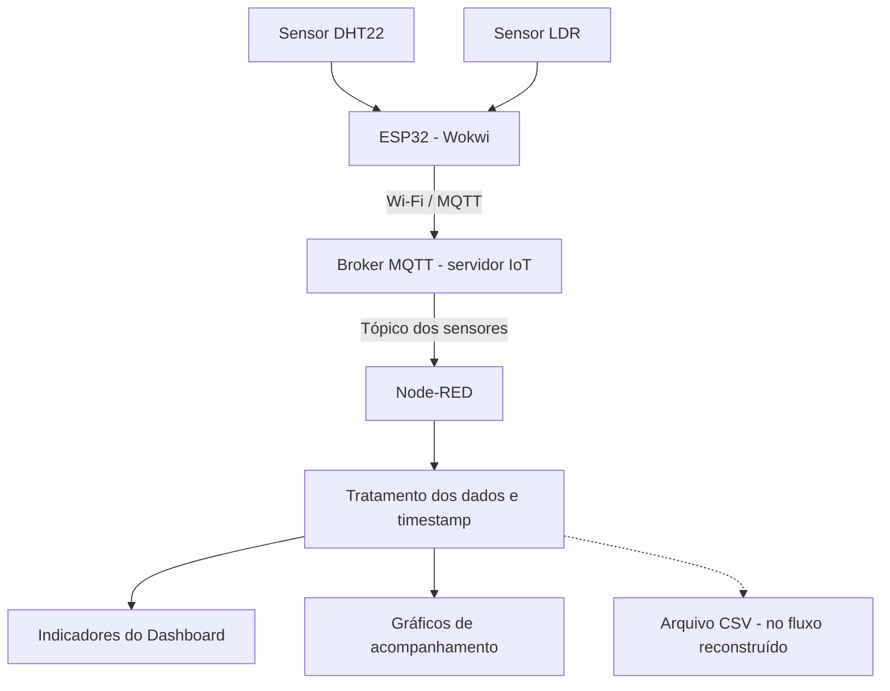

# Check Point 06 - Edge Computing & Computer Systems

## Vinheria Agnello - IoT com Dashboard

Projeto desenvolvido para o Check Point 06 da disciplina **Edge Computing & Computer Systems**, como evolução do monitoramento ambiental da Vinheria Agnello realizado no CP5. Nesta etapa, os dados dos sensores conectados ao ESP32 são enviados por MQTT e apresentados em um **Dashboard customizado no Node-RED**, com indicadores de temperatura, umidade e luminosidade, além de gráficos de acompanhamento.

A proposta é facilitar a observação das condições do ambiente de armazenamento de vinhos e a identificação de variações que possam exigir atenção.

## Links do projeto

**Projeto no Wokwi**  
https://wokwi.com/projects/478694558326385665

**Projeto anterior - CP5**  
https://github.com/JoaquimGSM/CP5_Edge

> O vídeo do CP5 documenta a etapa anterior com MQTT e FIWARE. Não se trata de uma demonstração do Dashboard do CP6.

## Integrantes

- Joaquim Gaspardo Souza Moura - RM572208
- Gabriel Ferreira Flausino - RM572486
- Gustavo Ducatti - RM570932
- Felipe Kenji Takata - RM568739

## Objetivo

O projeto realiza o monitoramento de três informações relevantes para o armazenamento dos vinhos:

- **Temperatura**
- **Umidade**
- **Luminosidade**

Esses dados são coletados pelo **ESP32 simulado no Wokwi** e publicados em um broker MQTT. No CP6, o **Node-RED** recebe as mensagens, transforma seus valores em dados numéricos e os encaminha ao **FlowFuse Dashboard 2.0**.

Diferentemente do CP5, em que o foco era a comunicação MQTT e a integração com o FIWARE, a principal evolução deste checkpoint é a **visualização em uma interface própria**, com indicadores e gráficos. O arquivo de fluxo incluído neste repositório também contém uma proposta de gravação em CSV, cuja persistência precisa ser validada após a importação.

## Tecnologias utilizadas

- ESP32 DevKit C V4
- Wokwi
- DHT22
- LDR
- Wi-Fi
- MQTT
- Node-RED
- FlowFuse Dashboard 2.0 (`@flowfuse/node-red-dashboard`)
- JavaScript (nós `function` do Node-RED)
- C++ / Arduino
- Arquivo CSV (mecanismo incluído no fluxo reconstruído; pendente de validação)

## Sensores

### DHT22

Responsável pela leitura de:

- Temperatura (°C)
- Umidade relativa do ar (%)

**Ligação utilizada:**

```text
VCC  -> 3V3
DATA -> GPIO 15
GND  -> GND
```

### LDR

Responsável pela leitura da luminosidade ambiente por meio da entrada analógica do ESP32.

**Ligação utilizada:**

```text
VCC -> 3V3
GND -> GND
AO  -> GPIO 34
```

O pino digital **DO** não foi utilizado. A leitura exibida representa o valor analógico do ESP32 (tipicamente entre **0 e 4095**), e não uma medição calibrada em lux.

### Esquema de ligação no Wokwi

As conexões podem ser verificadas no arquivo [`wokwi/diagram.json`](wokwi/diagram.json).

## Arquitetura do projeto



O ESP32 publica os dados aproximadamente a cada dois segundos. O Node-RED assina o tópico MQTT, interpreta a mensagem e a distribui para os componentes visuais.

## Configuração Wi-Fi

O ESP32 utiliza a rede disponibilizada pelo Wokwi:

```text
SSID: Wokwi-GUEST
Senha: sem senha
```

## Servidor MQTT

O projeto utiliza o servidor IoT informado durante a atividade:

```text
Broker MQTT: 3.135.234.101
Porta: 1883
```

A disponibilidade desse broker depende da infraestrutura externa. Caso o endereço seja alterado, será necessário atualizá-lo tanto no `sketch.ino` quanto no nó `mqtt in` do Node-RED.

## Tópicos MQTT

### Envio dos sensores

```text
/TEF/vinheria001joaquim/attrs
```

O ESP32 publica mensagens no formato delimitado por `|`:

```text
t|24.00|u|40.00|l|1001
```

Onde:

- `t` = temperatura em °C
- `u` = umidade relativa em %
- `l` = luminosidade analógica (ADC)

### Envio de comandos para o ESP32

```text
/TEF/vinheria001joaquim/cmd
```

O ESP32 permanece inscrito nesse tópico para receber mensagens MQTT, funcionalidade reaproveitada do CP5. O Dashboard do CP6 utiliza principalmente o tópico de envio dos sensores.

## Comunicação com Node-RED

No Node-RED, o nó **`mqtt in`** se conecta ao broker `3.135.234.101:1883` e assina o tópico `/TEF/vinheria001joaquim/attrs`.

As mensagens são enviadas a um nó **`function`**, que separa os valores de temperatura, umidade e luminosidade e cria um objeto JavaScript semelhante a:

```json
{
  "temperatura": 24,
  "umidade": 40,
  "luminosidade": 1001,
  "timestamp": "2026-10-30T13:58:24.008Z"
}
```

O exemplo acima representa o **formato** dos dados. O valor de `timestamp` é gerado pelo Node-RED no momento do recebimento da mensagem.

## Dashboard customizado

A interface foi desenvolvida com **Node-RED e FlowFuse Dashboard 2.0** e apresenta:

- Indicador de temperatura, em °C;
- Indicador de umidade, em %;
- Indicador de luminosidade, em valor analógico ADC;
- Gráficos de acompanhamento das leituras em função do tempo.

O fluxo utiliza nós `ui-gauge` e `ui-chart`, associados à página **Vinheria Agnello** e ao grupo **Sensores**. As leituras são atualizadas conforme novas mensagens chegam do ESP32.

**Arquivo do Dashboard:** [`node-red/flows.json`](node-red/flows.json).

> **Importante:** o `flows.json` disponível foi **reconstruído com base na implementação acompanhada durante o desenvolvimento**, pois não foi possível exportar o arquivo original do computador da faculdade. Essa reconstrução deve ser importada e testada antes de ser considerada uma cópia funcional do projeto apresentado presencialmente.

## Timestamp

Na versão do `sketch.ino` disponibilizada, as mensagens enviadas pelo ESP32 **não contêm data e hora**. O Node-RED acrescenta o campo `timestamp` ao receber cada mensagem:

```javascript
new Date().toISOString()
```

Portanto, esse campo representa **o horário de recebimento no Node-RED**, e não necessariamente o instante exato em que o sensor realizou a medição.

## Histórico de dados

Os gráficos do Dashboard permitem acompanhar a evolução recente das leituras de temperatura, umidade e luminosidade.

No **fluxo reconstruído**, foi incluída uma etapa adicional para salvar cada leitura em um arquivo CSV chamado:

```text
vinheria_agnello_historico.csv
```

O registro utiliza os seguintes campos, separados por ponto e vírgula:

```text
timestamp;temperatura;umidade;luminosidade
```

Exemplo de linha:

```text
2026-10-30T13:58:24.008Z;24;40;1001
```

**A gravação persistente em CSV foi acrescentada na reconstrução do fluxo e ainda precisa ser testada**. A visualização de pontos no gráfico, por si só, não comprova que os dados permanecerão disponíveis após reiniciar o Node-RED.

## Como executar

### 1. Abrir o projeto no Wokwi

Acesse o [projeto no Wokwi](https://wokwi.com/projects/478694558326385665) ou utilize os arquivos presentes em `wokwi/`.

Verifique se estão presentes:

- ESP32 DevKit C V4
- DHT22
- LDR

### 2. Verificar as bibliotecas

O arquivo [`wokwi/libraries.txt`](wokwi/libraries.txt) relaciona as bibliotecas utilizadas. O código inclui:

```cpp
#include <DHTesp.h>
#include <WiFi.h>
#include <PubSubClient.h>
```

### 3. Executar a simulação

Clique em **Start Simulation**. No **Serial Monitor**, verifique a conexão Wi-Fi, a conexão MQTT e a publicação periódica dos sensores.

### 4. Instalar e iniciar o Node-RED

Com o Node.js instalado, execute no terminal:

```bash
npm install -g node-red
node-red
```

Abra o editor em:

```text
http://localhost:1880
```

### 5. Instalar o Dashboard

No menu do Node-RED, acesse **Gerenciar paleta > Instalar** e instale:

```text
@flowfuse/node-red-dashboard
```

### 6. Importar o fluxo do CP6

No menu do Node-RED, selecione **Importar** e carregue o arquivo:

```text
node-red/flows.json
```

Verifique o broker, a porta e o tópico no nó `mqtt in`. Depois clique em **Implementar**.

O arquivo é uma **reconstrução não validada** da versão original; revise possíveis avisos de configuração antes de utilizá-lo.

### 7. Visualizar o Dashboard

Com o Wokwi em execução, acesse:

```text
http://localhost:1880/dashboard/vinheria
```

Acompanhe os indicadores e gráficos. Altere os valores dos sensores simulados para conferir se a interface é atualizada.

### 8. Verificar o histórico

Caso utilize a reconstrução do fluxo, confira se o arquivo `vinheria_agnello_historico.csv` foi criado na pasta do usuário que executa o Node-RED e se novas linhas são adicionadas. Para validar persistência, reinicie o Node-RED e confira se o arquivo conserva os registros anteriores.

## Estrutura do repositório

```text
CP6_Edge/
├── README.md
├── wokwi/
│   ├── sketch.ino
│   ├── diagram.json
│   └── libraries.txt
├── node-red/
│   ├── flows.json
│   ├── funcao-processamento.js
│   └── INSTRUCOES.md
└── imagens/
    ├── circuito-wokwi.png
    ├── bibliotecas-wokwi.png
    ├── dashboard-cp6.png
    └── fluxo-node-red-cp6.png
```

As imagens de Dashboard e fluxo registram **etapas do desenvolvimento** e não devem ser interpretadas como comprovação de que o arquivo reconstruído foi executado ou de que a persistência em CSV foi validada.

## Arquivos necessários

Para reproduzir o projeto, disponibilizamos:

- `wokwi/sketch.ino`: código do ESP32;
- `wokwi/diagram.json`: esquema de ligação do circuito;
- `wokwi/libraries.txt`: dependências da simulação;
- `node-red/flows.json`: fluxo reconstruído de MQTT, processamento, indicadores, gráficos e CSV;
- `node-red/funcao-processamento.js`: código de referência da transformação dos dados;
- `node-red/INSTRUCOES.md`: orientações complementares de importação;
- `imagens/`: registros visuais do circuito e de etapas do desenvolvimento.

## Resultado

Na demonstração prática, o sistema recebeu as leituras de temperatura, umidade e luminosidade transmitidas pelo ESP32 e as exibiu no Dashboard do Node-RED.

A evolução em relação ao CP5 foi a criação de uma interface própria para acompanhar os sensores, facilitando a compreensão das condições ambientais da Vinheria Agnello por meio de indicadores e gráficos.

Para fins de replicação, acompanha este repositório uma **reconstrução do fluxo Node-RED**. A exportação original da faculdade não estava disponível, e a funcionalidade de CSV adicionada na reconstrução precisa ser testada antes de ser apresentada como armazenamento persistente comprovado.
